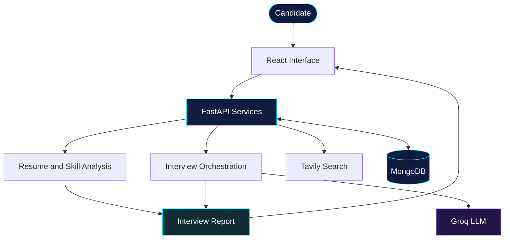
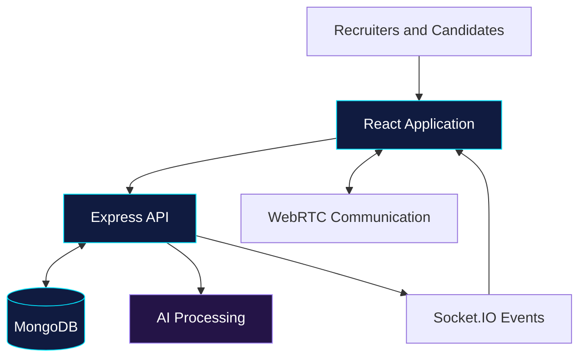
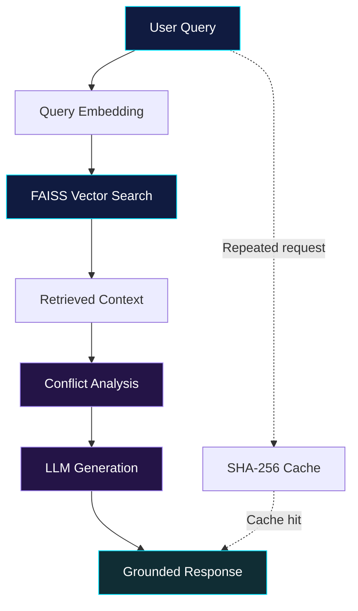

<!--
  SANKALP NIGAM — FUTURISTIC AI ENGINEERING PROFILE
  Repository: sandhruv/sankalpnigam
-->

<div align="center">


<br/>

<a href="https://github.com/sandhruv">

</a>
<a href="https://www.linkedin.com/in/sankalpnigam">

</a>
<a href="mailto:sankalpnigamofficial@gmail.com">

</a>


</div>

---

## `01 // SYSTEM IDENTITY`

```text
IDENTITY       Sankalp Nigam
ROLE           AI Engineer / Full-Stack Developer
EDUCATION      B.Tech Computer Science & Engineering
INSTITUTION    Lovely Professional University
PRIMARY FOCUS  RAG · LLM Applications · Backend Engineering
MISSION        Turn intelligent ideas into usable software
```

I'm a Computer Science and Engineering student interested in building AI-powered applications, intelligent retrieval systems, and end-to-end software products.

My approach combines applied AI with software engineering: retrieval, model orchestration, backend APIs, database design, user interfaces, and deployment.

- `> CURRENT BUILD` — Placement Prep Buddy
- `> EXPLORING` — RAG, LLM orchestration, AI agents, and cloud deployment
- `> ENGINEERING` — Python, Java, TypeScript, React, FastAPI, and Node.js
- `> INTERESTS` — System design, application reliability, testing, and performance

---

## `02 // TECHNOLOGY MATRIX`

<div align="center">

### `CORE LANGUAGES`


### `APPLICATION ENGINEERING`


### `AI / DATA SYSTEMS`


<br/>


</div>

---

## `03 // ACTIVE PROJECT SYSTEMS`

### `SYS.001` — Placement Prep Buddy

**AI-powered interview intelligence platform**

Upload a resume, choose a target role, identify skill gaps, practice with an AI interviewer, and receive structured feedback.

**SYSTEM MODULES**
- Resume-oriented preparation
- Skill-gap analysis
- Dynamic AI interview conversations
- Interview scoring and feedback reports

**STACK**

`React` `FastAPI` `Groq LLM` `Tavily` `MongoDB` `Render`

<div align="center">

<a href="https://placement-preparation-buddy-1.onrender.com/login">

</a>
<a href="https://github.com/sandhruv/placement-preparation-buddy">

</a>

</div>

**Architecture // Conceptual flow**



**Visual interface**

<!-- Upload a real screenshot to assets/placement-prep-buddy.png -->

<p align="center">
  
</p>

---

### `SYS.002` — Vettora

**Recruitment, screening and assessment platform**

A full-stack recruitment platform combining candidate workflows, resume processing, AI-assisted interview features, real-time communication, and assessment functionality.

**SYSTEM MODULES**
- Role-based access and recruitment workflows
- Resume processing and ATS-oriented functionality
- AI-assisted interview questions and audio analysis
- Real-time features using Socket.IO and WebRTC
- Assessment and anti-cheat functionality

**STACK**

`React` `Redux Toolkit` `Express` `MongoDB` `Socket.IO` `WebRTC` `Docker`

<div align="center">

<a href="https://cv-shortlisting-system-2.onrender.com/">

</a>
<a href="https://github.com/sandhruv/cv-shortlisting-system">

</a>

</div>

**Architecture // Conceptual flow**



<!-- Upload a real screenshot to assets/vettora-dashboard.png -->

<p align="center">
  
</p>

---

### `SYS.003` — SangamRAG

**Conflict-aware retrieval-augmented generation**

An experimental RAG application combining semantic retrieval with contradiction-aware processing before answer generation.

**SYSTEM MODULES**
- Document chunking and embedding
- FAISS vector retrieval using MiniLM
- Potentially contradictory claim detection
- SHA-256-based caching for repeated requests

**STACK**

`Python` `FastAPI` `FAISS` `Groq` `Ollama` `Docker` `Google Cloud Run`

<div align="center">

<a href="https://sangam-rag-frontend-524229321053.asia-south1.run.app">

</a>
<a href="https://github.com/sandhruv/sanagam-rag">

</a>

</div>

**Architecture // RAG pipeline**



*Conceptual architecture; validate exact processing and cache behavior against the implementation.*

---

### `SYS.004` — Document AI RAG

**Private-document question answering**

A document question-answering project using retrieval and language-model generation to help users query their own content.

`Python` `FastAPI` `React` `FAISS` `Sentence Transformers` `Groq`

[↗ INSPECT REPOSITORY](https://github.com/sandhruv/document-ai-rag)

---

### `SYS.005` — Batuni Chat App

**Real-time Android messaging**

An Android chat application built with Java, Firebase Authentication, Realtime Database, Fragments, and Adapters.

`Java` `Firebase` `Android SDK`

[↗ INSPECT REPOSITORY](https://github.com/sandhruv/batuni-chat-aap)

---

### `SYS.006` — Developer Portfolio

**Personal web presence**

A portfolio website built with Next.js App Router, TypeScript, and Tailwind CSS.

`Next.js` `TypeScript` `Tailwind CSS`

[↗ INSPECT REPOSITORY](https://github.com/sandhruv/sankalpnigam)

---

## `04 // ADDITIONAL REPOSITORIES`

| SYSTEM | DESCRIPTION | SOURCE |
|---|---|---|
| WhatsApp Automation Suite | Selenium and Tkinter desktop automation | [OPEN](https://github.com/sandhruv/WhatsApp-Automation-Suite) |
| Screenshot to Code | UI screenshot-to-code experimentation | [OPEN](https://github.com/sandhruv/screenshot-to-code) |
| Personal Budget Assistant | Python-based personal finance assistant | [OPEN](https://github.com/sandhruv/-Personal-Budget-Assistant) |
| Student Performance Prediction | Predictive analysis and ML | [OPEN](https://github.com/sandhruv/predictive-analysis) |
| LPU Portal | Document processing portal | [OPEN](https://github.com/sandhruv/lpu-portal) |
| Hand Gesture Control | Computer vision and gesture interaction | [OPEN](https://github.com/sandhruv/hand-gesture-) |
| LeetCode Solutions | Data structures and algorithms practice | [OPEN](https://github.com/sandhruv/leetcode_solution-summer-pep) |

---

## `05 // DEVELOPER TELEMETRY`

<div align="center">


</div>

*Statistics are supplied by third-party services and may be delayed, unavailable, or subject to their own counting rules.*

---

## `06 // CERTIFICATION ARCHIVE`

- **NPTEL** — Cloud Computing
- **Coursera** — Google AI Essentials
- **McKinsey.org** — Forward Program
- **Activeloop** — GenAI 360°
- **Lovely Professional University** — Logic Building and Data Structures

---

## `07 // NEXT ITERATION`

```text
[IN PROGRESS]   Strengthen RAG evaluation and retrieval quality
[EXPLORING]     LLM orchestration and agentic workflows
[BUILDING]      Reliable APIs and maintainable backend systems
[IMPROVING]     Cloud deployment, testing, and observability
[CONTINUING]    Data structures and algorithm problem solving
```

---

<div align="center">


### `END OF TRANSMISSION`

**BUILD INTELLIGENTLY. ENGINEER RELIABLY. KEEP SHIPPING.**

<a href="mailto:sankalpnigamofficial@gmail.com">EMAIL</a>
&nbsp; // &nbsp;
<a href="https://www.linkedin.com/in/sankalpnigam">LINKEDIN</a>
&nbsp; // &nbsp;
<a href="https://github.com/sandhruv">GITHUB</a>

<sub>Designed for the intersection of applied AI and software engineering.</sub>

</div>
