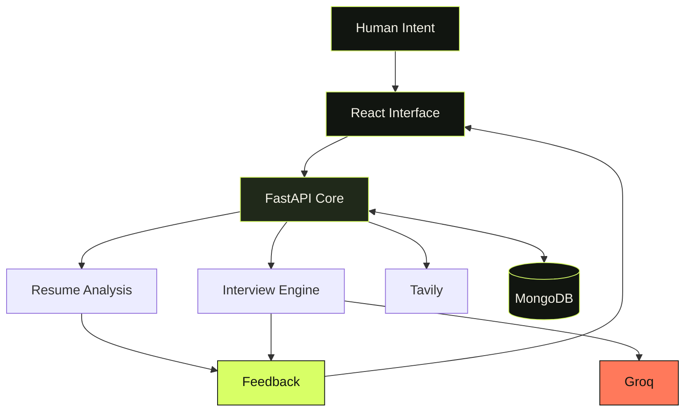
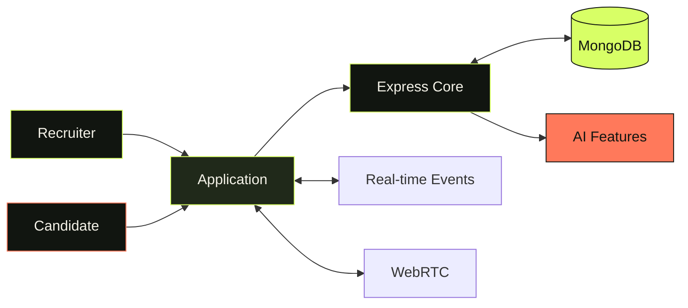
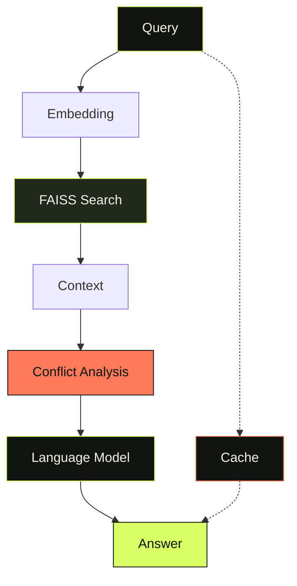

 <!-- SANKALP NIGAM | NEURAL ORGANISM -->

  

  

COMPUTER SCIENCE &nbsp; × &nbsp; APPLIED AI &nbsp; × &nbsp; SOFTWARE ENGINEERING

---

FIELD NOTES / 001

# I DON'T JUST WANT TO USE INTELLIGENCE.

# I WANT TO ENGINEER WHAT IT CAN DO.

I'm Sankalp — a Computer Science and Engineering student at Lovely Professional University, exploring how artificial intelligence and software engineering can work together to create useful products.

My work lives between two worlds: the reasoning capabilities of AI and the engineering required to turn those capabilities into working systems.

I build, experiment, debug, learn, and rebuild.

---

## 

THE INTELLIGENCE LAYER / MODELS, CONTEXT, RETRIEVAL

I explore the systems that give software the ability to interpret information, retrieve context, and assist people with complex tasks.

`LLM Applications` &nbsp; `RAG` &nbsp; `FAISS` &nbsp; `Semantic Search` &nbsp; `NLP` &nbsp; `AI Automation`

## 

THE APPLICATION LAYER / INTERFACES, SERVICES, DATA

An intelligent idea becomes useful only when people can interact with it. That's where frontend development, APIs, databases, and application architecture come in.

`React` &nbsp; `Next.js` &nbsp; `Node.js` &nbsp; `Express` &nbsp; `FastAPI` &nbsp; `REST APIs`

## 

THE DATA LAYER / PERSISTENCE, SEARCH, KNOWLEDGE

`MongoDB` &nbsp; `MySQL` &nbsp; `Firebase` &nbsp; `Vector Retrieval` &nbsp; `Data Processing`

## 

THE ENGINEERING LAYER / TOOLING, DEPLOYMENT, RELIABILITY

`Docker` &nbsp; `Cloud Deployment` &nbsp; `Git` &nbsp; `Testing` &nbsp; `Automation`

**Languages I use and study**

---

FIELD NOTES / 002

# SPECIMENS FROM THE LAB

*Every repository is an experiment in turning an idea into a system.*

<strong>SPECIMEN 001 / PLACEMENT PREP BUDDY</strong> — AI INTERVIEW INTELLIGENCE

 

**The problem:** Preparing for a role requires more than reading questions. Candidates need a way to identify gaps, practise, and learn from feedback.

**The build:** An AI-powered preparation platform featuring resume-oriented preparation, skill-gap analysis, dynamic interview practice, and feedback reports.

| ORGAN | IMPLEMENTATION |
|---|---|
| Interface | React |
| Service layer | FastAPI |
| AI | Groq |
| Search | Tavily |
| Storage | MongoDB |

**NEURAL PATHWAY**

<strong>SPECIMEN 002 / VETTORA</strong> — RECRUITMENT ECOSYSTEM

 

**The problem:** Recruitment involves multiple actors, candidate data, screening, and assessment workflows.

**The build:** A full-stack recruitment platform combining role-based workflows, resume processing, interview-related functionality, real-time communication, and assessments.

**ORGAN MAP**

`React` → `Redux Toolkit` → `Express` → `MongoDB`

`Socket.IO` · `WebRTC` · `Docker`

**SIGNAL PATHWAY**

<strong>SPECIMEN 003 / SANGAMRAG</strong> — CONTEXT & RETRIEVAL

 

**The exploration:** How can a retrieval pipeline surface relevant context and consider conflicting information before generating a response?

**The build:** A RAG application exploring semantic retrieval, FAISS, MiniLM embeddings, conflict analysis, and SHA-256-based caching.

**ORGAN MAP**

`Python` · `FastAPI` · `FAISS` · `MiniLM` · `Groq` · `Ollama` · `Docker`

**CONTEXT PATHWAY**

<strong>SPECIMEN 004 / DOCUMENT AI RAG</strong> — DOCUMENT INTELLIGENCE

 

Question-answering over documents through retrieval and language-model generation.

`Python` · `FastAPI` · `React` · `FAISS` · `Sentence Transformers` · `Groq`

[↗ ACCESS REPOSITORY](https://github.com/sandhruv/document-ai-rag)

<strong>SPECIMEN 005 / BATUNI</strong> — HUMAN CONNECTION

 

An Android messaging application built with Java and Firebase.

`Java` · `Android` · `Firebase`

[↗ ACCESS REPOSITORY](https://github.com/sandhruv/batuni-chat-aap)

<strong>SPECIMEN 006 / PORTFOLIO</strong> — DIGITAL IDENTITY

 

A personal portfolio repository built around modern web development.

`Next.js` · `TypeScript` · `Tailwind CSS`

[↗ ACCESS REPOSITORY](https://github.com/sandhruv/sankalpnigam)

---

FIELD NOTES / 003

# THE EXPERIMENTS DON'T STOP HERE.

| RESEARCH THREAD | DOMAIN |
|---|---|
| [WhatsApp Automation Suite](https://github.com/sandhruv/WhatsApp-Automation-Suite) | Automation |
| [Screenshot to Code](https://github.com/sandhruv/screenshot-to-code) | Interface engineering |
| [Personal Budget Assistant](https://github.com/sandhruv/-Personal-Budget-Assistant) | Personal finance |
| [Predictive Analysis](https://github.com/sandhruv/predictive-analysis) | Machine learning |
| [LPU Portal](https://github.com/sandhruv/lpu-portal) | Portal workflows |
| [Hand Gesture Control](https://github.com/sandhruv/hand-gesture-) | Computer vision |
| [LeetCode Solutions](https://github.com/sandhruv/leetcode_solution-summer-pep) | Algorithms and data structures |

---

FIELD NOTES / 004

# EVOLUTION IS MEASURED IN ITERATIONS.

*Not in decorative numbers.*

 

  

  

Data rendered by third-party services; availability and counting may vary.

---

## 

<strong>OPEN THE NEXT ITERATION</strong>

 

- Strengthen Java and data structures and algorithms.
- Improve RAG quality, evaluation, and retrieval pipelines.
- Explore LLM orchestration and agentic workflows.
- Build reliable APIs and maintainable backend systems.
- Improve testing, deployment, and application observability.

## 

- NPTEL — Cloud Computing
- Coursera — Google AI Essentials
- McKinsey.org — Forward Program
- Activeloop — GenAI 360°
- Lovely Professional University — Logic Building and Data Structures

---

 

  

HUMAN CURIOSITY × MACHINE INTELLIGENCE × ENGINEERING DISCIPLINE

 

END OF FILE // THE WORK CONTINUES

<!-- END OF README -->
