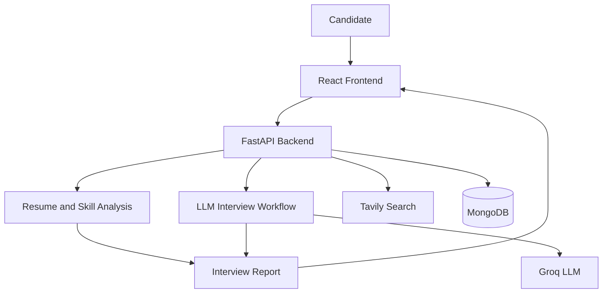
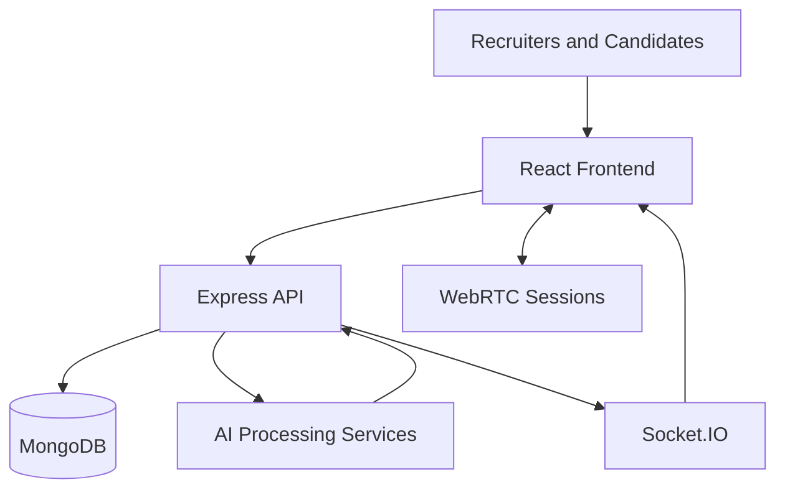
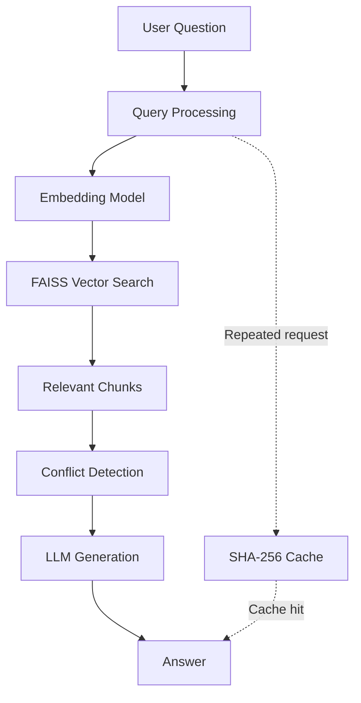

# Sankalp Nigam | AI Engineer & Full-Stack Developer

  

  
  
  

  

---

## About Me

I'm a Computer Science and Engineering student at **Lovely Professional University**, interested in building practical AI applications, intelligent backend systems, and full-stack products.

My focus is on connecting AI capabilities with real software engineering: retrieving relevant information, orchestrating language models, designing APIs, building usable interfaces, and deploying applications.

- **Currently building:** Placement Prep Buddy — an AI-powered interview preparation platform.
- **AI interests:** Retrieval-Augmented Generation (RAG), LLM applications, semantic search, and AI agents.
- **Engineering interests:** API design, backend architecture, databases, testing, and cloud deployment.
- **Core stack:** Python, Java, TypeScript, React, FastAPI, Node.js, and MongoDB.
- **Education:** B.Tech in Computer Science and Engineering, Lovely Professional University.

I'm particularly interested in building AI systems that are useful, measurable, maintainable, and accessible through well-designed software.

---

## What I Build

<table>
  <tr>
    <td width="50%" valign="top">
      <h3>🧠 Applied AI & RAG</h3>
      
Document retrieval, semantic search, vector databases, LLM-powered question answering, and retrieval pipelines.

      
<code>Python</code> <code>FAISS</code> <code>Sentence Transformers</code> <code>LLMs</code>

    </td>
    <td width="50%" valign="top">
      <h3>⚙️ Backend Engineering</h3>
      
REST APIs, authentication, data modeling, asynchronous workflows, integrations, and application architecture.

      
<code>FastAPI</code> <code>Node.js</code> <code>Express</code> <code>MongoDB</code>

    </td>
  </tr>
  <tr>
    <td width="50%" valign="top">
      <h3>🖥️ Full-Stack Development</h3>
      
Responsive interfaces connected to backend services, databases, and AI-powered application features.

      
<code>React</code> <code>Next.js</code> <code>TypeScript</code> <code>Tailwind CSS</code>

    </td>
    <td width="50%" valign="top">
      <h3>🚀 Deployment & Quality</h3>
      
Containerization, deployment workflows, automated browser testing, and performance-conscious development.

      
<code>Docker</code> <code>Google Cloud</code> <code>Render</code> <code>Selenium</code>

    </td>
  </tr>
</table>

---

## Featured Projects

### 01 · Placement Prep Buddy

**AI-powered interview preparation and skill-gap analysis**

An interview preparation platform designed to help candidates practice for specific roles, identify skill gaps, and receive structured feedback.

**Key capabilities**
- Resume-based preparation and role selection.
- Skill-gap analysis to guide preparation.
- Dynamic AI interviewer with follow-up questions.
- Scored interview reports and feedback.

**Technology:** React · FastAPI · Groq LLM · Tavily · MongoDB · Render

  
  

**Application preview**

<!-- Add a real screenshot at assets/placement-prep-buddy.png -->

  

**High-level architecture**

*Conceptual architecture based on the project's described components; not a runtime trace.*

---

### 02 · Vettora

**AI-assisted recruitment and assessment platform**

A full-stack recruitment system designed to bring candidate screening, interview workflows, assessment features, and role-based access into one application.

**Key capabilities**
- Role-based experiences for recruitment and candidate workflows.
- Resume processing and ATS-oriented functionality.
- AI-assisted interview question generation and audio analysis.
- Real-time application features using Socket.IO and WebRTC.
- Assessment and anti-cheat functionality.

**Technology:** React · Redux Toolkit · Express · MongoDB · Socket.IO · WebRTC · Docker

  
  

**Application preview**

<!-- Add a real screenshot at assets/vettora-dashboard.png -->

  

**High-level architecture**

*Conceptual overview; actual service boundaries may differ.*

---

### 03 · SangamRAG

**Conflict-aware Retrieval-Augmented Generation**

An experimental RAG system designed to retrieve relevant text and identify potentially contradictory claims before generating an answer.

**Key capabilities**
- Document chunking and semantic retrieval.
- Vector search using FAISS and MiniLM embeddings.
- Conflict-aware processing before answer generation.
- SHA-256-based caching for repeated requests.

**Technology:** Python · FastAPI · FAISS · Groq · Ollama · Docker · Google Cloud Run

  
  

**Pipeline architecture**

*Conceptual pipeline; confirm the precise cache and retrieval flow against the implementation.*

---

### 04 · Batuni Chat App

**Real-time Android messaging application**

An Android chat application built around Firebase authentication and real-time data synchronization.

**Key capabilities**
- Firebase Authentication.
- Realtime Database integration.
- Modular Android components using Fragments and Adapters.
- Responsive messaging interface.

**Technology:** Java · Firebase · Android SDK

  

<!-- Optional: add a real screenshot at assets/batuni-chat.png -->

---

### 05 · Document AI RAG

**Question answering over personal documents**

A document-focused question-answering application that combines retrieval with language-model generation to help users query their own content.

**Technology:** Python · FastAPI · React · FAISS · Sentence Transformers · Groq

  

---

### 06 · Portfolio Website

**Personal developer portfolio**

A portfolio website built with the Next.js App Router and TypeScript, styled using Tailwind CSS.

**Technology:** Next.js · TypeScript · Tailwind CSS

  

---

## More Projects

| Project | Description | Repository |
|---|---|---|
| WhatsApp Automation Suite | Desktop messaging automation using Selenium and Tkinter | [View repository](https://github.com/sandhruv/WhatsApp-Automation-Suite) |
| Screenshot to Code | UI screenshot-to-code experimentation | [View repository](https://github.com/sandhruv/screenshot-to-code) |
| Personal Budget Assistant | Python-based personal finance assistant | [View repository](https://github.com/sandhruv/-Personal-Budget-Assistant) |
| Student Performance Prediction | Machine learning and predictive analysis | [View repository](https://github.com/sandhruv/predictive-analysis) |
| LPU Portal | Document processing portal | [View repository](https://github.com/sandhruv/lpu-portal) |
| Hand Gesture Control | Computer vision and gesture interaction | [View repository](https://github.com/sandhruv/hand-gesture-) |
| LeetCode Solutions | DSA practice and problem-solving archive | [View repository](https://github.com/sandhruv/leetcode_solution-summer-pep) |

---

## Technology Stack

### Languages

  
  
  
  
  
  

### Frontend & Backend

  
  
  
  
  
  
  

### AI / ML

  
  
  
  
  
  

### Databases, Cloud & Tools

  
  
  
  
  
  
  
  

---

## GitHub Analytics

  
  

  

  

---

## Certifications & Learning

- NPTEL — Cloud Computing
- Coursera — Google AI Essentials
- McKinsey.org — Forward Program
- Activeloop — GenAI 360°
- Lovely Professional University — Logic Building and Data Structures

---

## Current Learning Roadmap

- [ ] Build more reliable RAG pipelines with evaluation and retrieval-quality testing.
- [ ] Explore agent workflows, tool calling, and LLM orchestration.
- [ ] Improve API security, automated testing, and backend reliability.
- [ ] Deepen cloud deployment and containerization skills.
- [ ] Continue practicing data structures and algorithms.

---

## Let's Connect

I'm interested in AI engineering, full-stack development, and projects that solve practical problems.

  
  
  

  <i>Building, learning, and shipping — one project at a time.</i>

