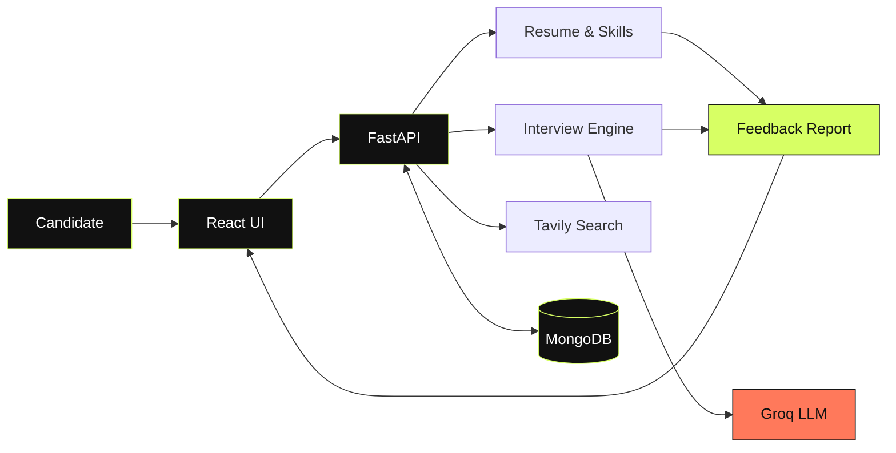
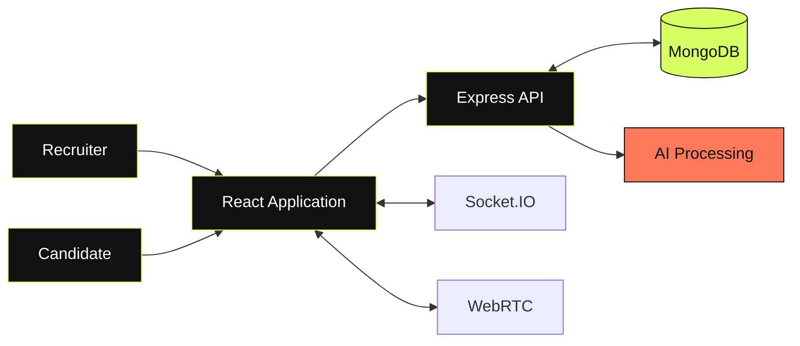
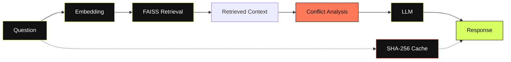

 <!-- README.md — SANKALP NIGAM -->

<div align="center">


<table>
<tr>
<td align="center" width="33%">
<strong>01 / THINK</strong><br/>
<sub>Understand the problem.</sub>
</td>
<td align="center" width="33%">
<strong>02 / ENGINEER</strong><br/>
<sub>Build the system.</sub>
</td>
<td align="center" width="33%">
<strong>03 / SHIP</strong><br/>
<sub>Make it usable.</sub>
</td>
</tr>
</table>

<br/>

<a href="https://github.com/sandhruv"></a>
<a href="https://www.linkedin.com/in/sankalpnigam"></a>
<a href="mailto:sankalpnigamofficial@gmail.com"></a>

<br/><br/>

<em>Computer Science student · AI systems · Full-stack engineering</em>

</div>

---

<div align="center">

### NOT JUST ANOTHER PROJECT REPOSITORY.

**A WORKBENCH FOR IDEAS THAT BECOME SOFTWARE.**

</div>

## `INDEX / 00` — THE OPERATOR

```text
NAME          Sankalp Nigam
BASE          Lovely Professional University, India
DISCIPLINE    Computer Science & Engineering
BUILD FOCUS   Applied AI / RAG / Backend / Full-Stack
APPROACH      Understand → Design → Build → Test → Improve
```

I’m a Computer Science and Engineering student interested in turning AI capabilities into useful, working products.

My work spans AI-powered applications, retrieval systems, recruitment platforms, developer tools, and application engineering. I enjoy exploring how models, data, APIs, interfaces, and deployment fit together to create a complete product.

- **Building:** AI-powered products and full-stack applications
- **Exploring:** RAG, LLM orchestration, AI agents, and system reliability
- **Engineering with:** Python, Java, TypeScript, React, FastAPI, and Node.js
- **Improving:** DSA, testing, backend architecture, and deployment practices

---

## `INDEX / 01` — CAPABILITY MAP

<div align="center">

<table>
<tr>
<td align="center" width="50%">

### BUILD


<sub>Languages · APIs · Application logic</sub>

</td>
<td align="center" width="50%">

### INTERFACE


<sub>Frontend · Components · User experience</sub>

</td>
</tr>
<tr>
<td align="center" width="50%">

### INTELLIGENCE


<sub>LLM applications · RAG · Computer vision</sub>

</td>
<td align="center" width="50%">

### INFRASTRUCTURE


<sub>Services · Data · Containers · Cloud</sub>

</td>
</tr>
</table>

</div>

**Concepts I work with**

`RAG` `FAISS` `LLM Applications` `Semantic Search` `REST APIs` `Automation` `Software Testing` `Data Structures`

---

## `INDEX / 02` — SELECTED BUILDS

<sub>REAL REPOSITORIES. REAL LINKS. A WORK IN PROGRESS.</sub>

### 01 — PLACEMENT PREP BUDDY

<sub> </sub>

**An AI-powered preparation workspace for job seekers.**

A platform designed to help candidates prepare for roles through resume-oriented preparation, skill-gap analysis, AI interview practice, and feedback reports.

| System layer | Technology |
|---|---|
| Interface | React |
| API | FastAPI |
| Language model | Groq |
| Search | Tavily |
| Persistence | MongoDB |
| Deployment | Render |

<div align="left">
<a href="https://placement-preparation-buddy-1.onrender.com/login"></a>
<a href="https://github.com/sandhruv/placement-preparation-buddy"></a>
</div>

**SYSTEM MAP**



---

### 02 — VETTORA

<sub> </sub>

**Recruitment workflows, candidate screening, and assessment.**

A recruitment and assessment platform combining role-based workflows, resume processing, interview-related features, real-time communication, and assessment functionality.

**ENGINEERING STACK**

`React` `Redux Toolkit` `Express` `MongoDB` `Socket.IO` `WebRTC` `Docker`

<div align="left">
<a href="https://cv-shortlisting-system-2.onrender.com/"></a>
<a href="https://github.com/sandhruv/cv-shortlisting-system"></a>
</div>

**SYSTEM MAP**



---

### 03 — SANGAMRAG

<sub> </sub>

**Exploring context retrieval and conflict-aware answers.**

A RAG project combining semantic retrieval with a conflict-analysis stage before language-model response generation.

**ENGINEERING STACK**

`Python` `FastAPI` `FAISS` `MiniLM` `Groq` `Ollama` `Docker` `Google Cloud Run`

<div align="left">
<a href="https://sangam-rag-frontend-524229321053.asia-south1.run.app"></a>
<a href="https://github.com/sandhruv/sanagam-rag"></a>
</div>

**SYSTEM MAP**



---

### 04 — DOCUMENT AI RAG

**Question-answering over documents using retrieval and generation.**

`Python` `FastAPI` `React` `FAISS` `Sentence Transformers` `Groq`

[↗ Explore repository](https://github.com/sandhruv/document-ai-rag)

---

### 05 — BATUNI CHAT APP

**Android messaging built with Java and Firebase.**

`Java` `Android` `Firebase`

[↗ Explore repository](https://github.com/sandhruv/batuni-chat-aap)

---

### 06 — DEVELOPER PORTFOLIO

**A personal web presence built with modern frontend tools.**

`Next.js` `TypeScript` `Tailwind CSS`

[↗ Explore repository](https://github.com/sandhruv/sankalpnigam)

---

## `INDEX / 03` — THE LAB

Smaller experiments and learning repositories, each exploring a different corner of software engineering.

| Repository | Exploration |
|---|---|
| [WhatsApp Automation Suite](https://github.com/sandhruv/WhatsApp-Automation-Suite) | Desktop automation |
| [Screenshot to Code](https://github.com/sandhruv/screenshot-to-code) | UI reconstruction |
| [Personal Budget Assistant](https://github.com/sandhruv/-Personal-Budget-Assistant) | Personal finance tooling |
| [Predictive Analysis](https://github.com/sandhruv/predictive-analysis) | Machine learning |
| [LPU Portal](https://github.com/sandhruv/lpu-portal) | Portal and document workflows |
| [Hand Gesture Control](https://github.com/sandhruv/hand-gesture-) | Computer vision |
| [LeetCode Solutions](https://github.com/sandhruv/leetcode_solution-summer-pep) | DSA practice |

---

## `INDEX / 04` — ENGINEERING SIGNAL

<div align="center">


<br/><br/>


<br/><br/>


</div>

<sub>Statistics are generated by third-party services. Availability and calculations may vary.</sub>

---

## `INDEX / 05` — LEARNING LOG

<details>
<summary><strong>OPEN CURRENT DEVELOPMENT TRACKS ↗</strong></summary>

<br/>

| Track | Direction |
|---|---|
| Java & DSA | Build problem-solving skills and algorithmic foundations |
| Applied AI | Improve retrieval, evaluation, and LLM application design |
| Backend engineering | Design maintainable APIs and data workflows |
| Cloud & reliability | Strengthen deployment, testing, and observability |
| Agentic systems | Explore tool use and multi-step AI workflows |

</details>

---

## `INDEX / 06` — CERTIFICATION ARCHIVE

- NPTEL — Cloud Computing
- Google / Coursera — AI Essentials
- McKinsey.org — Forward Program
- Activeloop — GenAI 360°
- Lovely Professional University — Logic Building and Data Structures

---

<div align="center">


<br/>

<a href="mailto:sankalpnigamofficial@gmail.com"></a>

<br/><br/>

<sub>DESIGNED WITH INTENT · BUILT THROUGH ITERATION</sub>

</div>

<!-- END README.md -->
